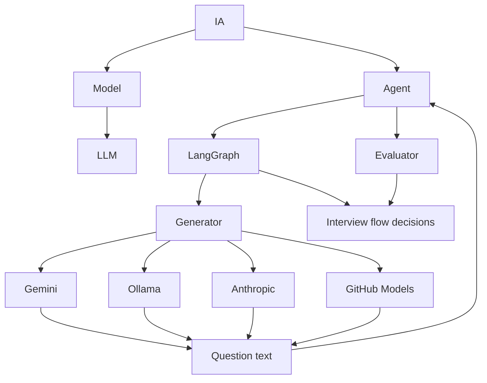

# Conceptos clave y su rol en este proyecto

## 1. IA

### Definición
La IA es el campo general de inteligencia artificial. En este proyecto, la IA no es un solo componente sino la capa de razonamiento y generación que ayuda a crear una entrevista adaptativa.

### Rol en el proyecto
La IA se usa para:

- generar preguntas relevantes para el puesto
- evaluar respuestas del candidato
- adaptar la dificultad de las preguntas
- decidir si la entrevista sigue, cambia de competencia o termina

### Conexión con el resto
La IA se materializa aquí como una combinación de:

- LangGraph como orchestrator
- model / LLM como motor generativo
- answer evaluator como camada de análisis
- generator como componente de prompting

---

## 2. Model

### Definición
Un model es el modelo de lenguaje o modelo de IA que genera texto o evalúa respuestas. Puede ser un modelo local o remoto.

### Rol en el proyecto
Los modelos se usan para:

- generar la siguiente pregunta del interview
- evaluar si la respuesta del candidato es buena
- interpretar contexto del rol y el desempeño

### Ejemplos usados en este proyecto

- Gemini
- Ollama
- Anthropic
- GitHub Models

### Conexión con el resto
El model es la pieza “inteligente” que produce el texto. Pero por sí solo no hace la entrevista entera: necesita que el agente le proporcione contexto y el graph le dé el estado del turno.

---

## 3. LLM

### Definición
LLM significa Large Language Model, o modelo grande de lenguaje. Es un tipo de model orientado a entender y producir texto.

### Rol en el proyecto
En esta app, el LLM se usa para:

- crear preguntas contextualizadas al puesto
- evaluar la respuesta del candidato con criterio técnico
- ajustar la entrevista según la calidad de la respuesta

### Conexión con el resto
El LLM se conecta a través de un adapter o generator. Es la parte que recibe el prompt y devuelve el texto final. LangGraph controla cuándo y por qué se invoca al LLM.

---

## 4. Agent

### Definición
Un agent es software que tiene estado, toma decisiones y usa herramientas o modelos para avanzar un objetivo.

### Rol en este proyecto
En este proyecto, el agent es el entrevistador inteligente:

- lleva el estado de la entrevista
- conoce la competencia actual
- conoce el rol y la descripción del puesto
- decide qué pregunta sigue
- evalúa respuestas
- decide si cambia de competencia o finaliza

### Conexión con el resto
El agent no es solo el LLM: tiene lógica de negocio y estado. El LLM es una herramienta que usa el agent para ayudar con la generación y la evaluación." 

---

## 5. LangGraph

### Definición
LangGraph es una librería para crear grafos de estado y orquestar flujos de trabajo con decisiones, rutas y memoria.

### Rol en este proyecto
LangGraph se usa para manejar el interview como un grafo de estado:

- turno actual
- competencia actual
- puntaje acumulado
- historial de decisiones
- final_route
- difficulty_level
- off-topic count

### Qué hace exactamente
LangGraph se encarga de:

- guardar el estado del candidato
- decidir cuál es la siguiente acción
- invocar al generator
- evaluar respuestas
- mover entre competencias
- decidir si concluye o escalates la entrevista

### Conexión con el resto
LangGraph es el orchestrator central. Es el que decide cuán importante es la respuesta y cuándo llamar al LLM. El LLM no reemplaza a LangGraph; LangGraph lo usa como una pieza dentro de su flujo.

### Lógica de las respuestas

Después de cada respuesta, el flujo evalúa el score, si está fuera de tema y si
contiene señales mezcladas. Esa evaluación actualiza la dificultad y permite
decidir la siguiente ruta:

- score `>= 0.75`: aumenta la dificultad hasta `high` y puede cambiar de
    competencia;
- score `<= 0.40`: reduce la dificultad hasta `low`;
- score intermedio: mantiene la dificultad y puede profundizar;
- `off_topic`: reduce la dificultad;
- dos respuestas `off_topic`: escala la entrevista para revisión.

El máximo actual es `max_turns=5`. La entrevista puede concluir antes si cubre
las competencias con suficiente confianza; si llega al último turno sin
calidad suficiente, se escala.

La evaluación puede hacerla el adapter de un LLM, como Gemini u Ollama, o el
evaluador determinístico local. En el motor `legacy`, que es el predeterminado,
se usa la evaluación local. El adapter LLM se utiliza con el motor `langgraph`
cuando está habilitado y el proveedor responde correctamente.

---

## 6. Gemini

### Definición
Gemini es el modelo de IA de Google usado como proveedor de generación y evaluación.

### Rol en este proyecto
Puede usarse para:

- generar preguntas de entrevista
- evaluar la calidad de respuestas

### Importante
Gemini puede fallar por cuota o por modelo no disponible. Por eso la app incluye fallback y soporte a otros proveedores.

### Conexión con el resto
Gemini se conecta a la app a través del generator/provider adapter. El graph no habla directamente con Gemini de forma manual; el generator hace esa llamada HTTP y devuelve el texto.

---

## 7. Ollama

### Definición
Ollama permite correr modelos locales en tu máquina sin depender del cloud.

### Rol en este proyecto
Es un proveedor local para pruebas y desarrollo. Muy útil cuando no querés depender de cuota ni de API keys externas.

### Conexión con el resto
Se usa exactamente igual que Gemini: el generator arma el prompt y llama al endpoint local de Ollama.

---

## 8. Anthropic

### Definición
Anthropic es un proveedor de IA con modelos como Claude.

### Rol en este proyecto
Puede usarse como alternativa de backend LLM para generar preguntas y evaluar respuestas.

### Conexión con el resto
La app incluye un adapter para Anthropic. El flow es el mismo: generator → HTTP request → response parsing → graph update.

---

## 9. GitHub Models

### Definición
GitHub Models es el servicio de inferencia de modelos a través de GitHub.

### Rol en este proyecto
Sirve como proveedor alternativo para generar preguntas con modelos accesibles desde GitHub.

### Conexión con el resto
También se integra con el mismo pattern: prompt → HTTP request → parse response → return question.

---

## 10. Generator

### Definición
El generator es la pieza que toma el estado del graph y arma el prompt final para el LLM. Es la capa de adaptación entre el graph y el modelo.

### Rol en este proyecto
El generator:

- toma el `InterviewGraphState`
- calcula la competencia actual
- incorpora role_description
- incorpora difficulty
- incorpora turn_index
- arma el prompt para el modelo
- limpia la respuesta del modelo
- devuelve la pregunta final

### Conexión con el resto
Es el puente principal entre:

- LangGraph state
- provider-specific HTTP request
- LLM response
- graph question update

Sin generator, el graph no sabe qué pedirle al modelo ni cómo transformar la respuesta en una pregunta legible.

---

## 11. Cómo se conectan unos con otros

La relación real es esta:

```text
Frontend
  -> FastAPI backend
  -> InterviewGraph (stateful agent)
      -> QuestionGenerator
          -> LLM provider (Gemini / Ollama / Anthropic / GitHub)
      -> response parsing
      -> next question
      -> answer evaluation
      -> route decision
```

### En palabras simples

- `LLM` genera texto
- `Model` es el motor que hace eso
- `Agent` es la lógica de decisión del entrevistador
- `LangGraph` es el contenedor del estado y las transiciones
- `Generator` es el adaptador entre estado y prompt
- `Gemini/Ollama/Anthropic/GitHub` son distintos proveedores del mismo servicio

---

## 12. Ejemplo real del flujo

Cuando el candidato empieza:

1. el frontend manda role y role_description al backend
2. backend crea un `InterviewGraph`
3. `role_description` se guarda en el state del graph
4. graph llama al `QuestionGenerator`
5. generator arma un prompt con role + job description + competency
6. el LLM responde con una pregunta
7. esa pregunta se muestra al candidato
8. el candidato responde
9. graph evalúa la respuesta
10. decide si sigue o cambia de ruta
11. vuelve a pedir otra pregunta al LLM con el nuevo estado

---

## 13. Resumen corto

- IA = concepto general
- Model = motor de lenguaje
- LLM = tipo de model que genera texto
- Agent = lógica de decisión del entrevistador
- LangGraph = orquestador del estado del interview
- Gemini / Ollama / Anthropic / GitHub = proveedores donde corre el modelo
- Generator = adaptador que construye el prompt y parsea la respuesta

Todos se conectan para formar un agente entrevistador que no solo hace preguntas, sino que decide, evalúa y adapta la entrevista en tiempo real.

---

## 14. Mapa visual de conexiones



Este diagrama resume la relación real:

- IA es el dominio general
- Model es el motor concreto
- LLM es la clase de model orientada a texto
- Agent es el que toma decisiones
- LangGraph es el orquestador del flujo
- Generator es el adapter de prompt
- Gemini/Ollama/Anthropic/GitHub son proveedores alternativos

---

## 15. Resumen ejecutivo de 1 línea

La idea central es: el agent usa LangGraph para llevar estado; el generator usa el model/LLM para producir texto; los proveedores son simplemente distintas rutas para llegar al mismo objetivo: hacer una entrevista técnica contextualizada y adaptativa.

---

## 16. Cómo se leen estas piezas en este proyecto

Si lo lees en el contexto del repo:

- `IA` = concepto amplio de inteligencia artificial
- `Model` = la implementación concreta del modelo
- `LLM` = el modelo de lenguaje que genera texto
- `Agent` = la lógica del entrevistador
- `LangGraph` = la máquina de estados y decisiones
- `Generator` = la pieza que formula el prompt
- `Gemini/Ollama/Anthropic/GitHub` = los backends de inferencia usados para ejecutar el modelo

Todos trabajan juntos para convertir la descripción del puesto en una entrevista real, adaptativa y técnica.
