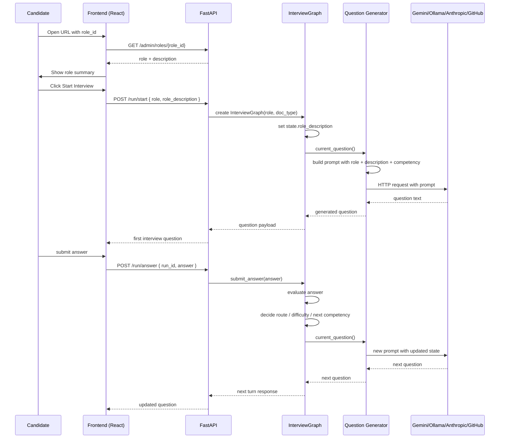
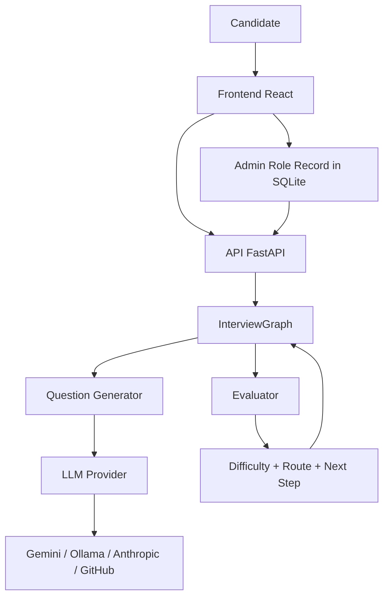
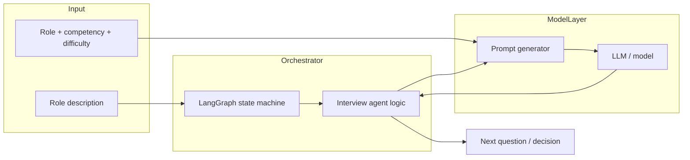
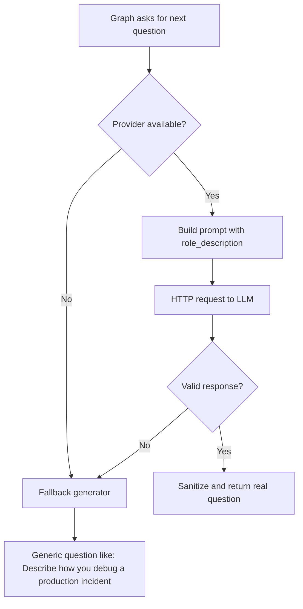
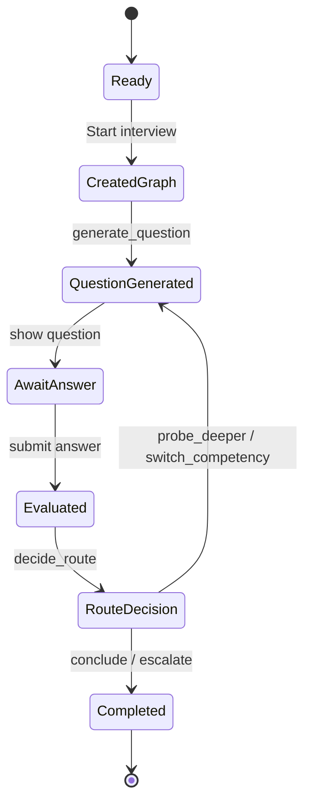

# LangGraph + LLM connection in AI Interviewer

## 1. Overview

This project is a candidate interview system with four main layers:

1. Frontend candidate UI
2. Backend FastAPI API
3. LangGraph interview orchestration runtime
4. LLM provider for question generation and answer evaluation

The user starts the interview from a URL that includes a role_id, for example:

http://127.0.0.1:4174/?role_id=sr_software_engineer

The frontend calls the admin API to fetch the role definition, then sends role + role_description to the backend when the candidate starts the interview.

---

## 2. Role flow

### 2.1 Admin creates a role
The admin stores a role record in the configured operational database (SQLite by default,
Postgres when enabled) with:

- role_id
- title
- location
- description
- created_at
- updated_at

This role description is the key context used later by the agent to ask domain-specific questions.

### 2.2 Candidate enters the URL
The candidate opens the interview link with a query string like:

- ?role_id=sr_software_engineer

The frontend reads the URL and fetches:

- GET /admin/roles/{role_id}

Example response:

```json
{
  "role_id": "sr_software_engineer",
  "title": "SR Software Engineer (Data)",
  "location": "Rochester, New York (Remote)",
  "description": "Senior Software Engineer with Data Skills..."
}
```

### 2.3 Candidate starts the interview
When the user clicks Start Interview, the frontend sends:

```json
{
  "role": "sr_software_engineer",
  "doc_type": "role_description",
  "role_description": "Senior Software Engineer with Data Skills...",
  "integrity": {}
}
```

to:

- POST /run/start

This is the critical wiring point: if role_description is missing, the agent does not have enough context and falls back to the generic question.

---

## 3. Backend runtime

The backend is in:

- project/services/api/main.py

The API first returns a warm-up prompt. After the candidate submits it, the API invokes the
compiled StateGraph and stores its checkpoint under the run ID. Each actual answer resumes
the `await_candidate` interrupt with `Command(resume=answer)`. Terminal routes pause at
`human_review`; the reviewer endpoint resumes that same checkpoint with the decision and
rationale, and only then does the `report` node complete.

SQLite checkpoint data is kept in `data/ai_interviewer.langgraph.sqlite3`. When Postgres is
selected, `AI_INTERVIEWER_LANGGRAPH_POSTGRES_DSN` points to a separate database to keep
LangGraph's fixed checkpoint tables separate from the operational tables.

---

## 4. InterviewGraph state model

The graph state lives in:

- project/services/agent/graph/models.py

The important fields are:

- role
- doc_type
- role_description
- current_competency_index
- competency_order
- turn_index
- max_turns
- difficulty_level
- confidence_sum
- evaluated_turns
- final_route
- decision_log

This state is what carries the interview memory between turns.

---

## 5. Question generation pipeline

The generation pipeline is defined in:

- project/services/agent/graph/questions.py

### 5.1 Environment-based selection
The code checks environment variables and picks the question provider:

- AI_INTERVIEWER_QUESTION_LLM_ENABLED
- AI_INTERVIEWER_QUESTION_LLM_PROVIDER

Supported providers:

- ollama
- gemini
- anthropic
- github_models

If the LLM is not enabled, it falls back to the deterministic generator.

### 5.2 Prompt building
The real question prompt is built by:

```python
_build_question_prompt(state)
```

This prompt includes:

- role
- doc_type
- current competency
- role_description
- turn_index
- max_turns
- difficulty
- remaining competencies

Example:

```text
You are an AI interviewer. Return exactly one interview question as plain text.
role=sr_software_engineer; doc_type=role_description; competency=debugging;
role_description=Senior Software Engineer with Data Skills...; turn_index=0; max_turns=5;
difficulty=medium; style=practical and moderately technical;
remaining_competencies=2
```

This is where the interview becomes role-aware.

---

## 6. How the LLM is actually called

### 6.1 Gemini example
The Gemini generator sends a request like:

```python
payload = {
    "contents": [{"parts": [{"text": _build_question_prompt(state)}]}],
    "generationConfig": {"temperature": 0.4},
}
```

Then it calls:

```python
https://generativelanguage.googleapis.com/v1beta/models/{model}:generateContent?key={api_key}
```

The returned payload looks like:

```json
{
  "candidates": [
    {
      "content": {
        "parts": [
          {"text": "How do you debug an LLM agent that enters an infinite loop?"}
        ]
      }
    }
  ]
}
```

The code extracts the text and sanitizes it before returning it to the graph.

### 6.2 Ollama example
For Ollama the call is:

```python
POST http://127.0.0.1:11434/api/generate
```

with payload:

```json
{
  "model": "llama3.1",
  "prompt": "...prompt built by _build_question_prompt(state)...",
  "stream": false,
  "options": {"temperature": 0.4}
}
```

and parses the `response` field.

### 6.3 Anthropic example
Anthropic uses:

```python
POST https://api.anthropic.com/v1/messages
```

with a `messages` payload and required header:

- anthropic-version
- Authorization: Bearer ...

### 6.4 GitHub Models example
GitHub Models uses:

```python
https://models.inference.ai.azure.com/chat/completions
```

with:

- Authorization: Bearer token
- model name
- user message payload

---

## 7. Connection between LangGraph and the LLM

This is the exact architecture:

- LangGraph stores the state of the interview
- the runtime calls a question generator
- the question generator builds a prompt using the state
- the prompt is sent to the LLM provider
- LLM returns a question text
- that text is used as the next question in the graph

This means the LLM is not replacing the graph; it is being used as a node inside the interview flow.

### The main contract

The graph state provides the context to the LLM:

- role
- doc_type
- role_description
- competency
- difficulty
- turn index

The LLM responds with only a plain-text question.

The graph then decides what to do next with the candidate answer.

---

## 8. After the candidate answers

When the candidate submits an answer:

- POST /run/answer

The backend loads the existing run state, then calls:

```python
step = run_context.graph.submit_answer(request.answer)
```

Inside the graph:

1. it invalidates the cached pending question
2. runs the turn logic
3. evaluates the answer
4. updates difficulty and competency progression
5. decides route:
   - probe_deeper
   - switch_competency
   - conclude
   - escalate
6. generates the next question if not complete

This is the loop:

Candidate answer -> evaluation -> decision -> next question.

---

## 9. Evaluation flow

The evaluation is done by:

- project/services/agent/graph/evaluator.py

It scores the answer based on:

- relevance to the competency
- depth of technical reasoning
- specificity and concrete examples
- off-topic detection

Then the graph updates the state:

```python
state.apply_answer_feedback(score, off_topic)
```

This directly changes:

- `difficulty_level`
- `confidence_sum`
- `evaluated_turns`
- `turn_index`

and can cause route switching or conclusion.

### 9.1 Reglas actuales de adaptación

La entrevista comienza con `difficulty_level=2`, que corresponde a dificultad
`medium`. Después de cada evaluación:

- si `score >= 0.75`, la dificultad aumenta un nivel, hasta `high`;
- si `score <= 0.40`, la dificultad disminuye un nivel, hasta `low`;
- si el score queda entre esos valores, la dificultad se mantiene;
- si la respuesta es `off_topic`, la dificultad baja directamente.

El valor actualizado se utiliza al construir el prompt de la siguiente
pregunta. Una buena respuesta puede producir una pregunta más profunda,
mientras que una respuesta débil produce una pregunta más básica.

El estado tiene `max_turns=5`, por lo que el flujo permite hasta cinco
preguntas/respuestas evaluadas. Puede finalizar antes si se cubren las
competencias con suficiente confianza.

La política de rutas funciona así:

- `score >= 0.75` y quedan competencias: cambia de competencia;
- `mixed_signal` y quedan competencias: cambia de competencia;
- si quedan pocos turnos para cubrir las competencias restantes, cambia de
  competencia obligatoriamente;
- `score >= 0.45`: profundiza con `probe_deeper`;
- al llegar al último turno sin calidad suficiente: `escalate`;
- con todas las competencias cubiertas, promedio acumulado `>= 0.70` y score
  actual `>= 0.55`: `conclude`;
- dos respuestas `off_topic`: `escalate` y finaliza para revisión.

### 9.2 Quién evalúa la respuesta

La evaluación puede ejecutarse de dos maneras:

1. Con el adapter LLM, cuando se usa el motor `langgraph` y el proveedor está
   habilitado. El modelo recibe la respuesta y devuelve un JSON con `score`,
   `off_topic`, `mixed_signal` y `evidence`.
2. Con `evaluate_answer(...)`, un evaluador determinístico local, cuando el LLM
   está deshabilitado o cuando el proveedor falla. Esta es también la ruta
   predeterminada del motor `legacy`.

El backend valida la salida del LLM antes de actualizar el estado. El modelo
propone la evaluación; la política del backend usa esos valores para decidir la
ruta siguiente.

Si el puntaje y los campos tienen el formato válido, se conserva la evidencia
tal como la devuelve el modelo, incluso si no coincide con la respuesta del
candidato. En ese caso se registra una advertencia en el backend. El puntaje
del LLM sigue afectando las decisiones y la evidencia puede contener texto del
puesto u otras frases no verificadas; debe ser revisada por una persona.

---

## 10. Why the generic question appears

The generic question appears when the system is not using the real LLM generator.

This happens when:

- LLM enabled flag is off
- provider env vars are missing
- provider returns an error
- quota is exhausted
- model is invalid or unavailable

Then the code falls back to:

```python
deterministic_question_for_competency(...)
```

and the generic question becomes visible.

This is the exact reason the first question may look like:

> Describe how you debug a production incident.

It is not necessarily “wrong context”; it is the fallback path triggered because no real provider answer was obtained.

---

## 11. Sequence diagram



---

## 12. Layered architectural diagram



This view makes the architectural layering explicit:

- the frontend is the user-facing layer
- the API is the transport and orchestration boundary
- the graph is the state machine
- the generator is the prompt adapter
- the model/provider is the generation engine
- the evaluator is the quality and routing layer

---

## 13. Simple mental model



The key idea is that LangGraph is not the model itself. It is the coordinator that gives the model the right context and then interprets the result.

---

## 14. Why the system can silently fall back to a generic question



This is the most important operational detail in the project: a generic question is usually a sign that the prompt path is not reaching a valid provider response, not necessarily that the role description disappeared from the database.

---

## 15. Practical interpretation for this repo

In AI Interviewer, the real question generation depends on three things working together:

1. The role has to be created in admin and saved correctly.
2. The candidate URL has to resolve to the same role_id.
3. The backend has to set role_description on the graph state before the first question is generated.

If any of those steps fail, the system can still answer with a generic fallback question even though the rest of the interview flow is technically running.

This is why the project required careful debugging around:

- admin role creation
- role retrieval by role_id
- frontend URL parsing
- backend request payloads
- graph state initialization
- provider connectivity and quota

---

## 16. Final summary

The architecture can be understood as this:

- admin stores the job description
- candidate opens the interview with a linked role
- backend creates a stateful interview graph
- graph injects role_description into the prompt
- generator sends the prompt to the selected model
- the model returns a contextual question
- the evaluator scores the response and routes the next step

That is the complete connection between LangGraph and the LLM in this app.

---

## 12. State diagram



---

## 13. Summary

The completed architecture does this:

- candidate enters a role-based interview link
- frontend loads the saved role description from admin
- backend creates a LangGraph state with role and role_description
- LangGraph asks the question generator for a next question
- the generator builds a prompt with role context and competency metadata
- the LLM provider returns a question text
- the graph evaluates the answer and keeps the interview moving

This is the real communication pattern between LangGraph and the LLM in this project.

---

## 14. Most important design takeaway

The interview is not driven by a random LLM without state.

It is driven by:

- a persistent graph state
- role-based prompt context
- adaptive difficulty logic
- question generation by provider
- answer evaluation and route decisions

That is what makes it an interview agent, not just a simple API call to a model.
